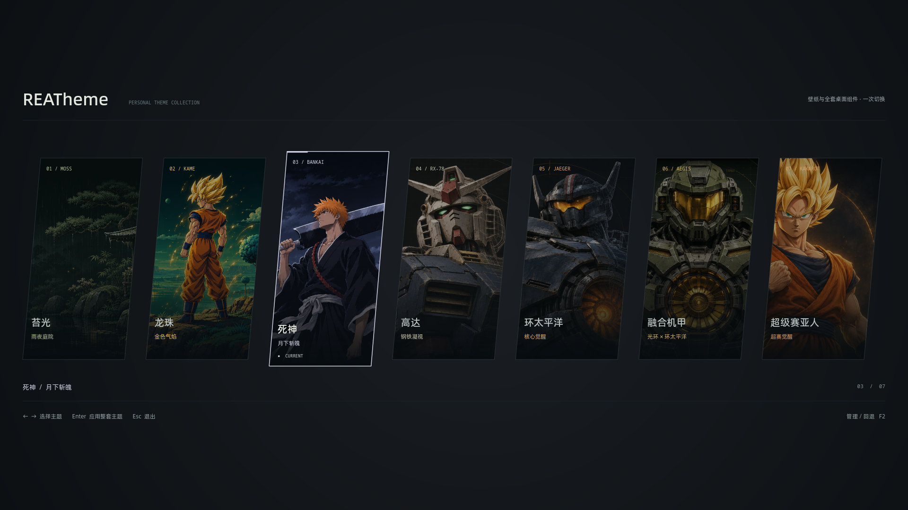

# REATheme v5.0



独立的原生 Qt6 主题应用。按 **Super + R** 打开应用菜单，搜索 **REATheme** 并回车启动。

选择器横贯屏幕排列七张平行四边形卡片，以各套壁纸的人物或场景局部作背景。当前主题带 CURRENT 标记；选择卡片时显示对应强调色与轻微抬升动画。

- 左右方向键（或上下键）：选择主题，支持首尾循环。
- Enter：应用完整主题，成功后关闭选择器；失败保留界面并显示原因。
- Esc：退出；正在应用时等待事务结束。
- 1–7：直接选择；Home / End：首张 / 末张。
- 鼠标单击：选择；双击：应用。
- F2：管理与回退，保留原有恢复与重新应用功能。

中文界面使用官网原版 **阿里巴巴普惠体 3.0**（Regular / Medium / Bold）；终端和时钟、资源读数等需要对齐的部分使用通用字体名 **monospace**。等宽中文回退到 Noto Sans Mono CJK SC，避免 TUI 表格与边线错位。字体来源见 fonts/SOURCE.md。

原有终端窗口可能继续使用已加载的旧字体，新开终端使用新设置。显示分辨率和缩放保持原值。

升级已有安装时请先备份配置。内部安装目录和备份目录保留 `mosslight` 名称，以兼容主题管理和恢复脚本。

应用二进制：bin/REATheme；入口：REATheme；源码：app/reatheme.cpp。应用与壁纸都随离线包保存，不依赖网页服务。其他 Linux 机器可用 `./app/build.sh` 编译（需要 C++17、pkg-config、Qt6Widgets / Qt6Gui / Qt6Core）；本包二进制为目标机器的 Linux x86_64 / Qt 6.12 构建。

可切换的 Hyprland 主题合集。壁纸、窗口边框、终端、应用菜单、通知和顶部栏统一配色。
v4 新增整套组件联动：Hyprlock 锁屏、电源菜单、配色文件夹图标与主光标、GTK3 文件管理器外观、SDDM 登录页。七套主题都已覆盖。
窗口边框统一为 1px；gaps_in 与 gaps_out 均为 3px。七套主题同步生效，改动前的主题布局保存在 revisions/layout-before-v3.2/。

所有顶部栏为 20 个 Wayland 逻辑像素，外边距为 0。本机内屏已调整为 1920×1080、1 倍缩放；切换主题保留显示设置。

| 主题 | 配色与场景 | 命令参数 |
|---|---|---|
| 苔光 · 雨夜庭院 | 苔绿、炭灰、雨夜庭院 | mosslight |
| 龙珠 · 金色气焰 | 金色超级赛亚人、那美克星 | dragonball |
| 死神 · 月下斩魄 | 黑崎一护、墨紫月夜 | bleach |
| 高达 · 钢铁凝视 | 装甲与机械线稿融合的半身近景 | gundam |
| 环太平洋 · 核心觉醒 | 半身重装机甲、蓝灰与炉心橙 | pacific-rim |
| 光环 × 环太平洋 · 融合机甲 | 正面原创融合机甲、金色面罩与胸部反应炉 | halo-fusion |
| 龙珠 · 超赛觉醒 | 金发超级赛亚人、无胡须的原作脸型、成熟材质 | goku-mature |

旧版高达机库、旧版环太平洋港口已从当前主题库移除。过去的版本压缩包作为历史归档保留。

## 使用

点击顶部栏主题标记打开 REATheme；右键该标记打开应用启动器。管理与回退位于 REATheme 的 F2 菜单。
新增两套也分别提供 Apply-halo-fusion.sh、Apply-goku-mature.sh。

```sh
~/.local/share/themes/mosslight/theme.py menu
~/.local/share/themes/mosslight/theme.py apply halo-fusion
~/.local/share/themes/mosslight/theme.py apply goku-mature
~/.local/share/themes/mosslight/theme.py restore
~/.local/share/themes/mosslight/theme.py bar-style classic
~/.local/share/themes/mosslight/theme.py bar-style designed
```

restore 恢复最初美化前的原始桌面。bar-style 仅切换顶部栏旧版/专属版偏好；壁纸保持当前主题。
新打开的 foot 终端使用新配色。当前窗口可能需重新打开才会采用配色。

## 完整桌面组件

| 组件 | 联动内容 | 使用方式 |
|---|---|---|
| Hyprlock | 当前主题壁纸、时钟、1px 方形密码框 | Super + L；顶栏电源图标右键 |
| 电源菜单 | 当前主题菜单配色、主题标识 | Super + Shift + P；顶栏最右侧 ⏻ |
| 文件夹图标 | 原创细线 SVG、主题强调色 | GTK 文件管理器自动使用 |
| 主光标 | 原创棱角箭头、主题强调色、24px | 随主题自动切换；其他指针继承 Adwaita |
| GTK3 / PCManFM | 深色背景、工具栏、选中态、细边框 | 随主题切换；已有窗口必要时重新打开 |
| SDDM | 当前壁纸、渐变遮罩、时间、登录表单 | 下次注销或开机显示 |

电源菜单包含锁屏、注销、重启、关机；后三项需要在菜单内再次选择确认。不会自动锁屏，也不会修改自动登录或系统认证。
锁屏使用现有系统密码。登录页支持输入用户名及选择 Hyprland 会话。SDDM 选择只修改主题设置，不重启服务。

主题菜单新增“恢复组件升级前桌面”和“重新应用上次主题”。也可直接运行：

```sh
./Restore-Components.sh  # 一键退回本次组件扩展前的桌面
./Reapply.sh             # 一键恢复上次使用的完整主题
./Restore.sh             # 恢复最初美化前的桌面配置
```

本机升级前配置存于 ~/.local/state/mosslight/pre-v4。回退比较包含文件原始内容、原本不存在的文件、dconf 显式值/未设置状态，以及 SDDM 主题选择。回退保留已安装的主题素材，便于再次应用。
“恢复原桌面”还会恢复原 Hyprland 配置；“恢复组件升级前桌面”保留本次升级前已调好的显示设置。

## 安装与备份

依赖 Python 3、Hyprland（Lua 配置）、Waybar、hyprpaper 0.8+、Hyprlock、Rofi、foot（colors-dark）、mako、GTK3、gsettings/dconf、Qt6 Widgets 与 Wayland 平台插件、SDDM 0.21+（Qt6）、QtQuick Controls Basic、Adwaita 图标/光标、Noto 等宽 / CJK 字体。普惠体随包安装。
从 GitHub 安装（适用于已配置 Hyprland Lua 环境的 Linux；请先安装上述依赖）：

```sh
git clone https://github.com/reasonz/REATheme.git ~/.local/share/themes/mosslight
cd ~/.local/share/themes/mosslight
./app/build.sh
sudo ./Install-System.py
./theme.py apply halo-fusion
```

在 Hyprland 会话中应用后，按 Super + R 搜索 REATheme。首次安装系统组件需要管理员权限，日常主题切换使用普通用户运行。
系统安装器将七套登录页复制到 /usr/share/sddm/themes/mosslight-*，安装 root 所有的 /usr/local/sbin/mosslight-login-theme。sudoers 只允许当前安装用户选择固定的七套登录主题及恢复原选择，不能传入路径或执行其他命令。之后日常主题切换不需输入管理员密码。
SDDM 专用配置为 /etc/sddm.conf.d/99-mosslight.conf；首次安装前状态封存于 /var/lib/mosslight-login/original.json。其他机器若已有优先级更高的 /etc/sddm.conf 中的 Theme/Current，应先处理该覆盖设置。

首次应用封存 ~/.local/state/mosslight/original 与 previous，重复应用不会覆盖已有备份内容。v4 对旧清单只补充新增组件的原状态。本机 original 采用最初美化前的 pixel-desktop-backup。每次应用建立事务快照，校验失败自动回退。
主题包不含个人备份、登录凭据或帐号数据。原始备份留在目标机器。回退会覆盖本主题管理的配置文件，如手动修改请先另存。

## 素材

壁纸由内置 imagegen 创作，为同人主题插画；提示词位于各主题 ART-DIRECTION.txt。
每套在 variants/<参数名>/ 下包含壁纸、配置、说明与实机预览。最初的苔光素材位于包根目录。
20px 顶部栏设计与交互说明见 BAR-DESIGNS.md。

实现参考：[Hyprlock 官方配置](https://wiki.hypr.land/hypr-ecosystem/user/hyprlock/)、[SDDM 官方主题接口和测试模式](https://github.com/sddm/sddm/wiki/Theming)、[GTK3 CSS](https://docs.gtk.org/gtk3/css-overview.html)、[图标主题继承规范](https://specifications.freedesktop.org/icon-theme/latest/)。

验证记录见 VALIDATION-v4.0.txt。锁屏配置通过程序解析；为不中断正在使用的桌面，没有测试实际锁定/密码解锁。SDDM 通过测试模式加载和实机预览，没有注销进行真实登录测试。


## 许可

应用源码沿用本仓库的 [Apache License 2.0](LICENSE)。第三方字体版权和使用条件见 [fonts/SOURCE.md](fonts/SOURCE.md)；随包主题插画包含同人题材，相关角色与商标归各自权利人所有，不纳入应用代码的许可证授权。
